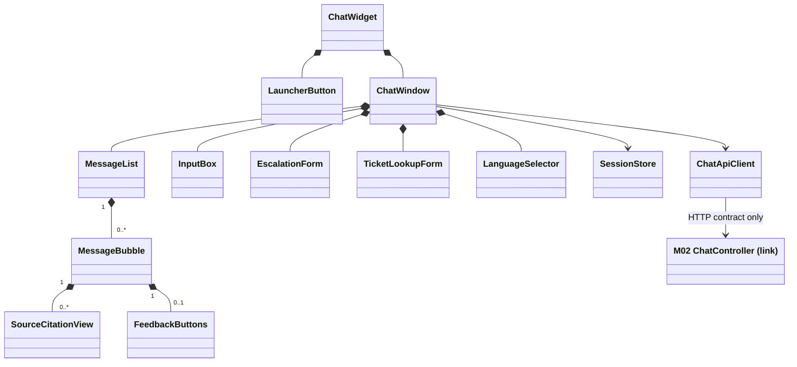

# M01 Chat Widget: class diagram

Embeddable chat interface (frontend). Components rather than server classes.

Legend: grey dashed boxes are classes owned by other modules. They are links only and are not redrawn here.

Attributes and methods are added in Phase 5 (architecture and design).
