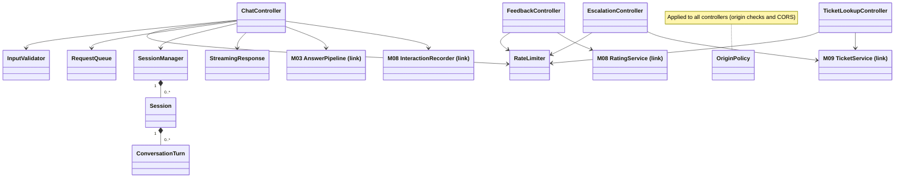

# M02 Chat API: class diagram

Single entry point for end-user traffic: sessions, validation, rate limiting, streaming, overload control.

Legend: grey dashed boxes are classes owned by other modules. They are links only and are not redrawn here.

Attributes and methods are added in Phase 5 (architecture and design).
