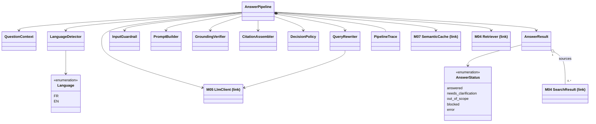

# M03 RAG Orchestrator: class diagram

Turns a question into an answer: language, rewriting, guardrails, cache, retrieval, generation, grounding, citations, decision.

Legend: grey dashed boxes are classes owned by other modules. They are links only and are not redrawn here.

Attributes and methods are added in Phase 5 (architecture and design).
