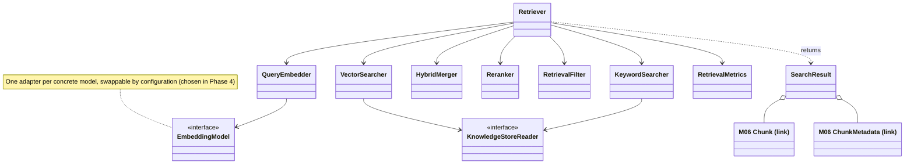

# M04 Retrieval: class diagram

Finds the most relevant passages fast. Owns the EmbeddingModel interface, which M06 and M07 link to so ingestion and querying use the same model.

Legend: grey dashed boxes are classes owned by other modules. They are links only and are not redrawn here.

Attributes and methods are added in Phase 5 (architecture and design).
