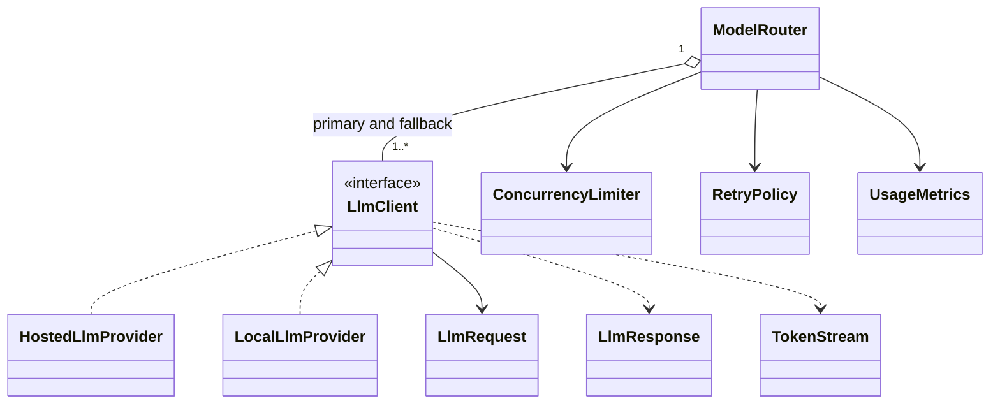

# M05 LLM Gateway: class diagram

Isolates the language model behind one interface: hosted or local, streaming, retries, fallback, concurrency limits.

Attributes and methods are added in Phase 5 (architecture and design).
