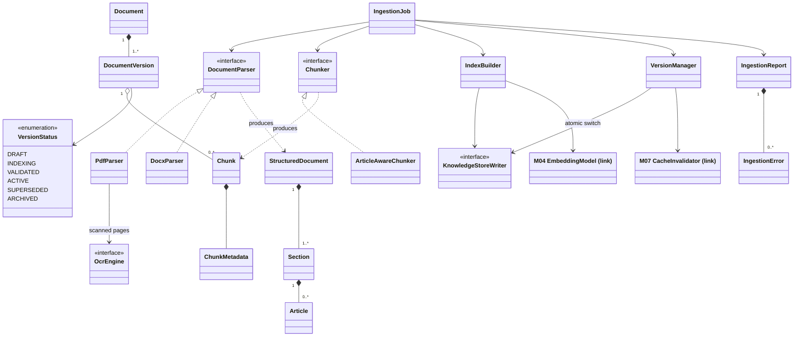

# M06 Knowledge Ingestion: class diagram

Offline pipeline: parse, OCR, chunk, embed, index, version, atomic switch. Owns the Chunk and ChunkMetadata contract read by M04.

Legend: grey dashed boxes are classes owned by other modules. They are links only and are not redrawn here.

Attributes and methods are added in Phase 5 (architecture and design).
