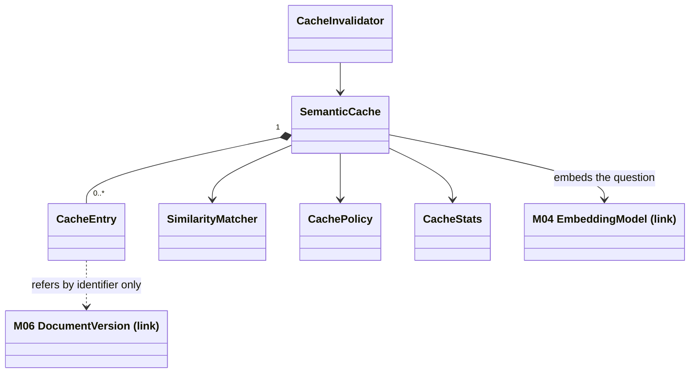

# M07 Semantic Cache: class diagram

Serves frequent questions without calling the LLM. Entries expire when a source document changes.

Legend: grey dashed boxes are classes owned by other modules. They are links only and are not redrawn here.

Attributes and methods are added in Phase 5 (architecture and design).
