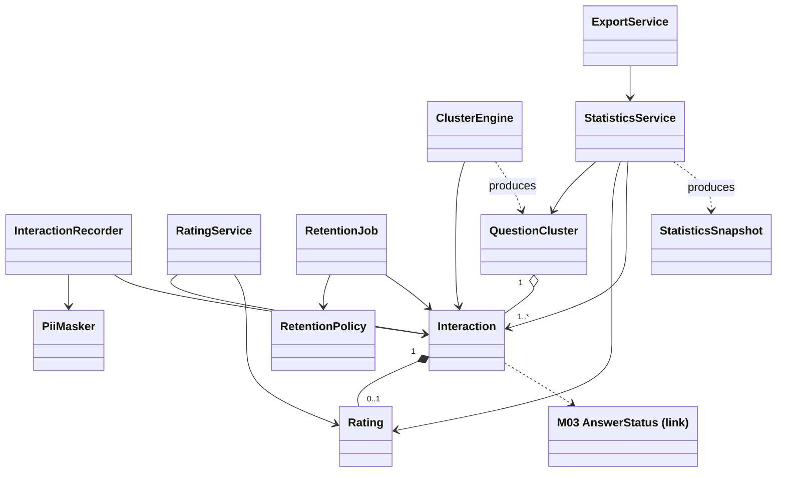

# M08 Feedback and Analytics: class diagram

Stores interactions and ratings with PII masking, groups similar questions, produces statistics and exports.

Legend: grey dashed boxes are classes owned by other modules. They are links only and are not redrawn here.

Attributes and methods are added in Phase 5 (architecture and design).
