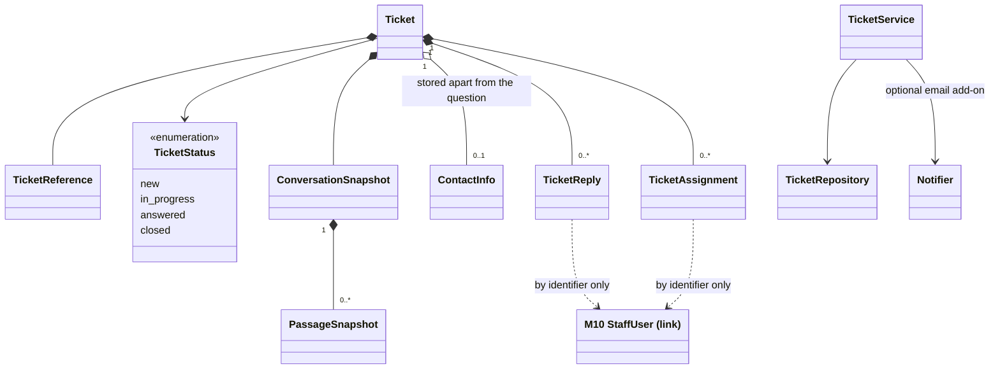

# M09 Human Support: class diagram

Escalation tickets for questions the bot cannot answer: reference numbers, status workflow, replies, retrieval by reference.

Legend: grey dashed boxes are classes owned by other modules. They are links only and are not redrawn here.

Attributes and methods are added in Phase 5 (architecture and design).
