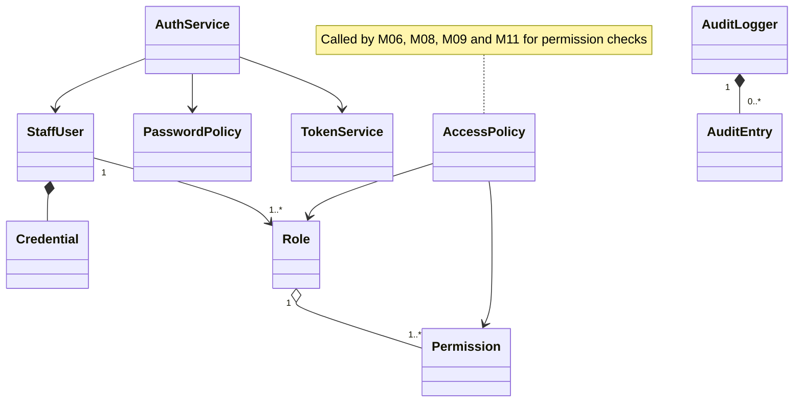

# M10 Identity and Access: class diagram

Staff authentication, roles and permissions, audit trail. Other modules call AccessPolicy to check permissions.

Attributes and methods are added in Phase 5 (architecture and design).
