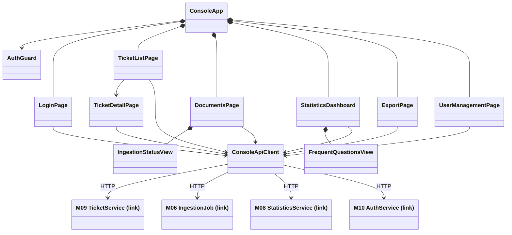

# M11 Staff Console: class diagram

Web interface for support agents and administrators (frontend). Calls the staff endpoints of M06, M08, M09 and M10 over HTTP.

Legend: grey dashed boxes are classes owned by other modules. They are links only and are not redrawn here.

Attributes and methods are added in Phase 5 (architecture and design).
