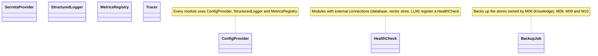

# M12 Platform: class diagram

Cross-cutting services used by every module: configuration, secrets, logging, metrics, tracing, health checks, backups.

Attributes and methods are added in Phase 5 (architecture and design).
